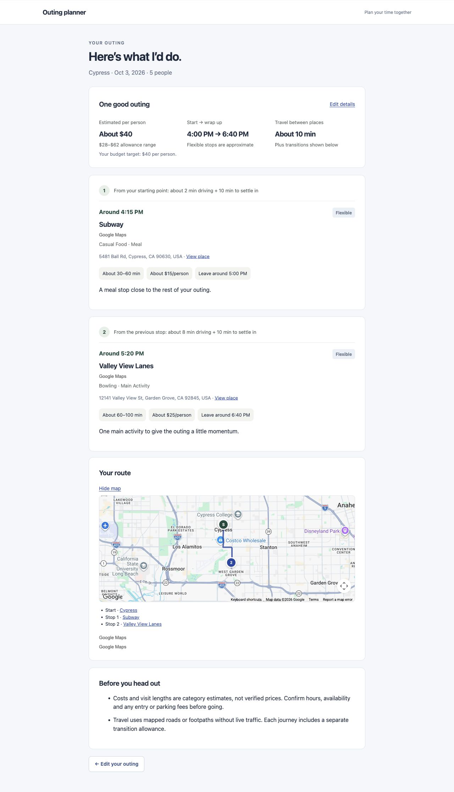
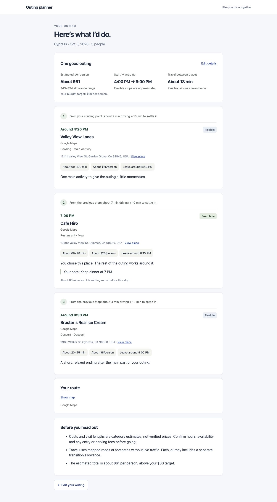
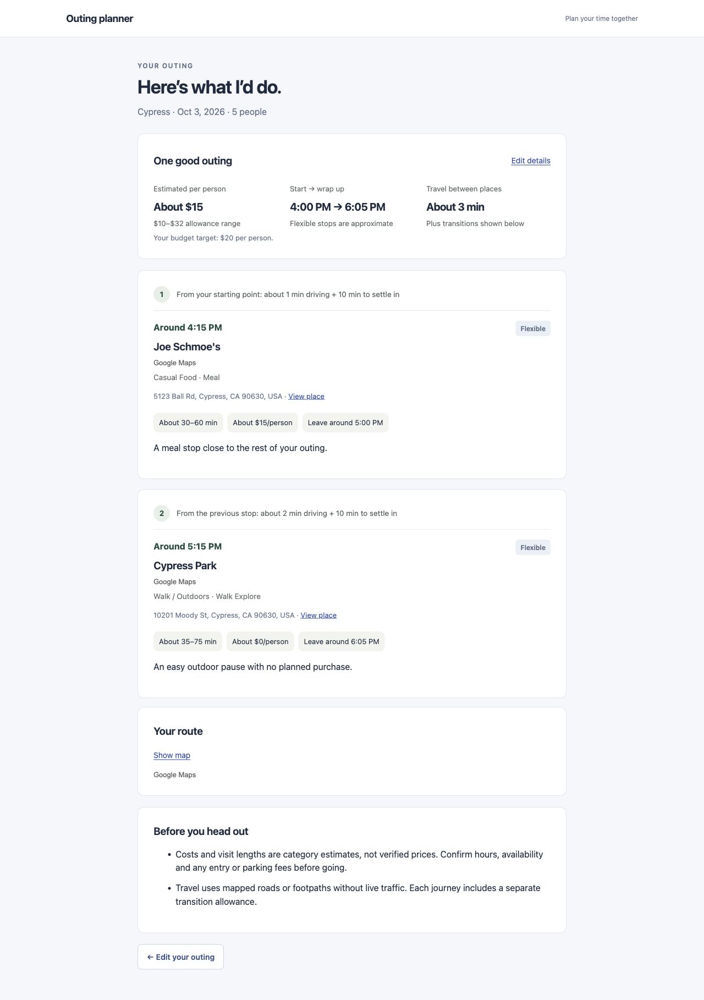

# Batch 3 handoff — first real planning loop

Prepared October 2, 2026. The app is running at [http://127.0.0.1:5174/](http://127.0.0.1:5174/). This is a local address on Abhinav’s computer. The same address reflects later local code edits while the server is running.

The build is ready for Josh + Abhinav’s benchmark review. Engineering checks do not automatically graduate this batch. Stop here; no swapping, regeneration, chatbot, weather, accounts, social or payment work has started.

## 1. Planner architecture

The existing React + TypeScript + Vite app is preserved. A small Node server owns provider credentials, real place discovery, routing and planning. Native SQLite stores founder run IDs, user decisions and product metrics. It does not become a permanent Google business catalog.

The flow is: guest draft → validated structured request → refreshed provider identities → intent and candidate normalization → real route matrix → bounded scheduling → final validation → one itinerary. UI, world access, routing, planning rules and itinerary types remain separate.

## 2. Real-place search provider

Google Places API (New) supplies autocomplete, selected-place details, Nearby Search and Text Search. US suggestions are explicitly restricted with `includedRegionCodes: ['us']`. Returned details and search candidates must have a US country component. No synthetic place or OSM result is substituted when Google fails.

The old OSM adapters and synthetic catalog remain available for isolated engineering tests. The running consumer app uses Google.

## 3. Route/travel provider

Google Routes API supplies directional route matrices and route geometry. Driving is the primary supported planning mode. Walking uses real walking routes. Transit scheduling is deferred and returns a useful failure rather than pretending to have bus/train schedules.

## 4. Normalized candidate model

`PlaceReference` contains provider, provider Place ID, display name, formatted address, coordinates, primary/additional types, fetched timestamp, provenance and a small metadata object. Suggestions are a separate type and cannot claim coordinates before selection.

`CandidatePlace` adds category, experience role, estimated cost and duration ranges, vibe/interest tags, source confidence, structured opening information, estimate notes, user stop ID, fixed status, fixed/preferred timing and user notes. Raw Google objects do not enter planning state or UI components.

Google identity is distinct from human intent. Direct Google details may return a newer canonical ID for the same selected address; the returned canonical ID is retained without searching for a replacement or changing fixed status, timing or notes. [Google documents that one place can have multiple IDs and IDs can change.](https://developers.google.com/maps/documentation/places/web-service/place-id)

## 5. Intent/vibe normalization

`lightweightIntent` is a replaceable local interface. Explicit word mappings recognize chill/lowkey/hang, active/adventurous/sports, flicks/movies, food/dinner, walks/outdoors, bowling/fun, coffee and dessert. They produce mood, interests, desired roles, search categories and budget policy. There is no AI service or consumer chatbot.

At a sufficient budget, active intent favors a physical activity over an easy walk. Low budgets retain free outdoor alternatives. The live LA comparison selects bowling for active and a walk for chill.

## 6. Hard constraints

Every user-selected place remains mandatory, including flexible places. Fixed arrival/end times and user durations stay exact. Known closure conflicts, overlapping commitments, unreachable routes, malformed identity/coordinates, repeated places, insufficient visit/travel time and explicit budget caps reject a plan. Automatic stops with severe budget mismatch are rejected. Fixed choices are never silently removed to make the numbers fit.

Today cannot start in the past. The server verifies the current time using the selected Google origin’s supplied UTC offset, with the browser timezone as fallback. It rechecks the clock during planning.

## 7. Soft scoring factors

Inspectable factors include vibe, interest, experience role, category, budget fit, user identity and available hours information. Sequence scoring also penalizes travel burden, waiting, deviation from flexible preferred times and late outdoor visits. Automatic dessert prefers to follow a meal. A normal budget is a target; a small overshoot may pass with an explicit warning.

Google does not supply reliable group capacity here. Larger groups receive a capacity/seating reminder rather than fabricated suitability facts.

## 8. Open windows

Fixed commitments are sorted chronologically. Their start/end or estimated duration identifies windows before, between and after them. Routing and transition allowances are applied while scheduling inside those windows. A fixed end-only commitment derives an arrival from the chosen duration. A fixed dinner is not moved when an earlier activity does not fit.

## 9. Duration estimates

Category defaults provide central values and ranges: casual meal 45 minutes, sit-down meal 75, coffee 35, dessert 30, bowling 80, cinema 130, active visit 75 and easy outdoor walk 50. User-entered duration or start/end overrides the default. Unknown duration is allowed at intake. Movie showtimes, activity sessions and access requirements remain unverified and are called out.

## 10. Cost estimates

Category allowances are per person in integer USD cents: casual meal 1500, sit-down meal 2800, coffee/dessert 800, bowling 2500, cinema 1800 and an outdoor visit 0 planned purchase. Each estimate includes a low/high allowance and a source note. These are product estimates, not Google menu/ticket prices. Parking, entry fees, tax and tips may vary.

The user’s $40 budget becomes `budgetPerPerson: { amountCents: 4000, currency: 'USD' }`, independently of `groupSize`. Stop costs are summed per person. No division by group size occurs.

## 11. Route estimates

One matrix returns travel minutes and metres in both directions. Driving uses `TRAFFIC_UNAWARE`, so the plan does not claim live traffic knowledge. Durations round upward to whole minutes. Each nonzero driving journey adds 10 minutes to settle in; walking adds 5. There is no straight-line-to-driving conversion or fabricated route fallback.

Route polylines load when the map is opened and stay off the plan generation path.

## 12. Selection algorithm and performance

Discovery runs up to four searches concurrently, usually around the origin and one distant existing anchor. Google search returns useful hours directly; those details are reused within that request instead of fetching each place again. Known closed candidates are removed before pruning.

The shortlist keeps the best candidates per role plus a cheaper alternative, preserving every user choice. Normal Google runs bound the pool to 13 candidates. One route matrix covers that pool. A beam of up to 64 states examines small plans, normally at most four stops. The search rewards useful roles rather than maximizing stop count. Very large sets of existing stops can exceed this prototype’s route limit and return a clean conflict.

Each Google call times out after 8 seconds. The complete build has a 27-second response deadline, including identity refresh. This deadline returns a no-plan explanation; it does not guarantee an external service will always supply a usable plan. The latest 10 successful live LA scenarios took **255–875 ms** end to end; the deliberately impossible scenario returned in 64 ms. These timings describe the tested runs, not a universal latency guarantee.

## 13. Sequencing algorithm

Scheduling considers directional travel, opening intervals, visit lengths, fixed arrivals and the next fixed stop’s travel allowance. Flexible times use five-minute increments. Desired finish has a 15-minute allowance; mandatory fixed commitments can extend beyond that target with a warning. No extra meal is added when an existing dinner already serves the meal role. Existing flexible places may be reordered to fit geography and reservations.

## 14. Final validation

The final plan checks valid real references, unique place IDs, nonnegative cost/travel, actual driving mode for driving requests, travel plus buffers between visits, positive durations, completion within a single outing including one overnight, known opening hours across both dates, every existing identity and all supplied fixed dates/times/ends/durations. A failed validation produces an explanation, never a fake plan.

## 15. Itinerary UI

“Here’s what I’d do.” now presents one real itinerary. Cards show human 12-hour times, real name/address, role/category, duration range, estimated cost/person, travel and transition time, a short fit reason, fixed/flexible status, notes and relevant warnings. Totals show per-person allowance, planned start/finish and travel. Fixed 7:00 PM appears only when the user enters it.

The intake keeps all five states, polished AM/PM controls and a calendar that also accepts a manually typed date. Full selected addresses appear in the search input. Removed helper/footer text and the green selected-place box stay removed. Diagnostics are absent from the normal flow.

## 16. Map

Google Maps JavaScript API renders the origin as S and itinerary stops as numbered Advanced Markers. Google route geometry connects the sequence. Built-in Google attribution remains visible. The map was visually verified in the browser with both keys accepted. Missing configuration or map authentication failure displays an error instead of a different map provider’s fabricated fallback.

## 17. Conflict/no-plan handling

Overlapping fixed stops, impossible travel, unavailable places, empty candidate supply, provider errors and deadlines keep the request available for editing. An activity without a specific venue asks one geographic clarification. Unselected arbitrary text is not verified geography. No-plan results never silently move a fixed reservation.

## 18. Current assumptions

- Coordinates can represent the center of a city/area rather than a driveway.
- Unknown Google hours remain unknown and require confirmation. Structured regular hours vary by weekday; current dated exceptions override them when supplied.
- Costs, durations and vibe tags are category estimates, with user duration taking priority.
- Future outing times are local clock times at the origin. The current provider UTC offset checks “now”; it is not used to invent future daylight-saving rules.
- The finish is a preference. Fixed reservations are hard commitments.
- A complete outing can end before the desired finish; empty time is not filled just to occupy it.

## 19. Known weak spots and remaining blockers

No implementation blocker remains in the checks completed here. Founders still need to judge real usefulness before graduating.

Intent matching is lightweight; it cannot understand arbitrary complex language. The limited category shortlist can miss a better venue, and many categories share estimated costs. Current data is real Google data, not a guarantee that every listing/hours entry is perfectly accurate. Session availability, tickets, menu prices, parking and group capacity are not verified. Flexible sequencing can leave visible breathing room before a reservation. Manually supplied flexible dessert stops can appear earlier if that scores better geographically.

Refresh returns to the preserved input form and re-fetches place IDs; rebuild to refresh the itinerary. There are no accounts or cross-device drafts. Vite reports a large lazy legacy MapLibre chunk; the Google consumer path does not load that legacy map. The Google Advanced Marker SDK logs an event-method warning, but marker/map display works.

The subsequent hosting change adds a Sites cloud entry point and D1 run storage while retaining the local Node preview and the same planner. Public founder routes and run diagnostics are blocked. Terms/Privacy pages are accessible. The Google browser key must allow the hosted domain; API credentials are configured as runtime secrets. Nothing in this batch adds payments, accounts or a booking promise.

## 20. Test results

`pnpm test`: **81 passed, 0 failed**. `pnpm build`: TypeScript and production bundle passed. `git diff --check`: passed. The Google foundation script passed **11 live checks**, including canonical address refresh through Build My Plan. The LA script passed **11 scenarios** (10 complete outings plus one expected conflict). The live scenario output in `artifacts/batch3/live-results.json` stores IDs, user decisions and product estimates; it does not archive a Google business catalog.

The latest LA runs use October 3, 2026, 4 PM onward because October 2’s example 6 PM start had already passed while testing. Today’s past-start rejection was tested separately.

| Founder benchmark | Result/evidence |
| --- | --- |
| 1. Nothing planned | Pass: real LA meal + bowling, about $40/person, 6 minutes mapped travel. |
| 2. Anchor | Pass: selected real activity remains in the itinerary and fixed by identity. |
| 3. Reservation | Pass: selected restaurant remains exactly 7:00 PM. Browser additionally verified Cafe Hiro at 7:00 PM with its note. |
| 4. Partial plan | Pass: live mixed fixed/flexible request; browser selected three separate real venues, one fixed and two flexible. All three survived refresh. |
| 5. Budget | Pass: $20 target selected about $15 meal + free outdoor stop; $80 selected about $53 sit-down meal + bowling. $60 browser target allowed a warned $61 plan. |
| 6. Vibe | Pass: chill selected a walk; active selected bowling. Different Place IDs were asserted in the live script. |
| 7. Geography | Pass for tested LA/Cypress plans: compact directional routes; LA totals 3–11 minutes. Automatic long journeys rejected. Not an exhaustive geographic test. |
| 8. Time | Pass: real travel, buffers and visit durations fit; fixed 7 PM retained. UI shows 12-hour times. |
| 9. Failure | Pass: incompatible fixed 7 PM and 7:15 PM stops returned no-plan. Offline/missing key/auth/invalid/inactive/zero-result behavior covered with isolated provider tests. |
| 10. Regression | Pass: all five states, structured inputs, $40 for five people, local date, present-time bound, refreshed selections, guest flow and clean consumer language. |

An extra almost-complete case preserved three supplied places and fixed dinner, estimating $48/person. Founder browser search returned Irvine Lanes and Bowlero Orange County with Google IDs, coordinates, address and inspectable hours. Inspection and scenario selection worked. Phone-width form/calendar verification at 390 × 844 showed no horizontal overflow.

## 21. Three generated real plans

These are browser captures of actual Google-backed generated results on October 2, not mockups. They are review evidence, not reusable place supply.







## 22. Files/components to know

| Responsibility | Files created or changed |
| --- | --- |
| Application/server | `src/App.tsx`, `server/start.mjs`, `server/durableRun.ts` |
| Guest intake | `src/components/PlanningForm.tsx`, `ExistingStopEditor.tsx`, `PlacePicker.tsx`, `Field.tsx`, `TimeInput.tsx`, new `DateInput.tsx`, `src/styles.css` |
| Request/state | `src/planning/types.ts`, `draft.ts`, `state.ts`, `validate.ts`, new `clock.ts` |
| Google provider / normalization | new `server/googleProvider.ts`, `src/world/types.ts`, `reference.ts`, `client.ts`, new `durable.ts`; `server/worldProvider.ts` retains the legacy test adapter |
| Routing | new `server/googleRouting.ts`, `server/routingProvider.ts` (legacy test adapter), `src/routing/types.ts` |
| Planning | new `server/realPlanner.ts`, `src/planner/types.ts`, `intent.ts`, `estimates.ts`, `schedule.ts` |
| Results / maps / attribution | new `src/itinerary/realPlan.ts`, `src/components/ItineraryResults.tsx`, `GooglePlaceMap.tsx`, `SourceAttribution.tsx`, `src/world/googleMapLoader.ts`; changed `PlaceMap.tsx` |
| Founder surfaces | `src/founder/PlaceLab.tsx`, `metadata.ts`, new `RunInspector.tsx` |
| Tests | changed `tests/planning.test.ts`; new `clock.test.ts`, `google.test.ts`, `real-planner.test.ts`; existing catalog/provider tests retained |
| Live checks / evidence | new `scripts/verify-live-plans.mjs`, `verify-google-foundation.mjs`, `artifacts/batch3/` |
| Setup / documentation | `.env.example`, `package.json`, `pnpm-lock.yaml`, `tsconfig.json`, `README.md`, new `GOOGLE_MAPS_SETUP.md`, this report |

The only new dependency is a development type package, `@types/google.maps`. Existing project/runtime dependencies remain. `.env.local` and local SQLite data are ignored by Git; no credential values are included in this handoff.

## 23. Suggested GitHub commit

`feat: build real outing plans with Google places and driving routes`

No commit or GitHub push was performed. This checkout has no Git remote configured.

## Stage A/B follow-through

| Requested item | Status |
| --- | --- |
| A fixes / budget root cause | Per-person contract and UI are explicit. The historical $8 display was not reproducible in the inspected baseline, which already stored cents per person; no division by group size was found. The exact historical cause is unverified rather than invented. New planner tests lock the behavior. |
| Budget storage | USD integer cents, independently stored group size. $40 × five remains 4000 cents per person. |
| Date default | Fresh guest tab displayed October 2, the browser’s current local date. Manual October 3 entry and calendar selection remain available. |
| Time storage/display | `HH:mm` internally; separate hour/minute/AM-PM controls and 12-hour consumer output. Past starts disabled/validated; fixed 7 PM remains `19:00` in state. |
| Consumer cleanup | No founder/debug/test labels in intake or results. Requested budget/start/finish/footer helper text and green selection card removed. Location guidance moved above input. |
| Stage A retests A1–A6 | Pass across automated tests and browser checks: budget, fresh date, 4 PM–11 PM, fixed 7 PM, consumer language and complete guest flow. |
| Current Google APIs | Places API (New): Autocomplete, Details, Nearby Search, Text Search; Routes API: matrix and routes; Maps JavaScript API: maps and Advanced Markers. No legacy Google endpoint. |
| Cloud setup | Both local keys saved and accepted. Setup for replacement/other machines is in `GOOGLE_MAPS_SETUP.md`. Billing plus all three APIs are required. Cloud restriction settings were not independently audited through the console. |
| Credential security | Server key stays server-side; browser configuration exposes only the browser key. Recommended server IP/API restrictions and browser website/Maps JS restrictions are documented. No hard-coded key or `VITE_` server secret. |
| Autocomplete | Debounced US lookup, maximum five suggestions, UUID session token, details only after selection. Unselected text invalidates previous verification. |
| Existing real places | Each stop selects independently; async identity updates preserve the latest fixed/timing/note edits. Nothing planned requires no existing stop. |
| Google field masks | Identity: ID, name, address, coordinates, types, business status, country components, Maps URI, attributions, current UTC offset. Planning additionally requests regular/current hours. No wildcard, photos, reviews, ratings or menu-price data. |
| Persistence | Google IDs + user intent are durable; provider content is refreshed after reload/build. Full active-run metadata lives in bounded memory; durable diagnostic records hold IDs and product metrics. |
| Founder search | `/founder`: text search, optional geography/category, at most eight candidates, details inspection and independent in-memory scenario selection. Not Explore. |
| Future interfaces | `WorldProvider` provides autocomplete/search/details/batch details. `RoutingService` provides matrix/route estimates. UI uses `worldClient`; planning receives injected services. |
| Routes status | Implemented and verified for driving and walking; live traffic and transit deferred. |
| Attribution/policy | Google places display on Google maps. Text/third-party attribution accompanies non-map data. Autocomplete sessions terminate at selection. No permanent Google catalog. Public Terms/Privacy remain a deployment prerequisite. |

| Original Google manual test | Result |
| --- | --- |
| 1. Cypress | Live suggestion, valid Google ID and coordinates passed. |
| 2. Street address | Public 1600 Amphitheatre Parkway selection passed, including canonical ID refresh. |
| 3. Real OC anchor | Disneyland lookup passed; generated-plan anchor preservation passed separately. |
| 4. Fixed dinner | Cafe Hiro browser selection retained 7 PM, fixed status and user note. |
| 5. Three-place partial | Browser selected Cafe Hiro, Valley View Lanes and Bruster’s independently: one fixed, two flexible; refresh retained all three. |
| 6. Founder search | “bowling near Irvine” returned real candidates; browser inspection and scenario selection passed. |
| 7. Geographic context | Cypress-biased food search and local generated routes passed. |
| 8. Unresolved text | Live API rejects it; picker clears resolved selection when text changes. |
| 9. API failure | Offline/auth/missing-key/invalid/stale/inactive/zero-result cases passed in isolated tests. No live key disablement or Google outage was induced. |
| 10. Budget | Live five-person request preserves $40/person; consumer shows About $40. |
| 11. Time | Browser 4 PM → 11 PM controls preserved normalized values; results use standard AM/PM times. |
| 12. Guest flow | Generated real plans, retained structured request, and refresh recovery passed without login. |

Remaining non-blocking limitations are in section 19. No further Google Cloud action is required for the verified local preview. Public deployment requires owner configuration described above.

## Founder checklist and setup

Run from `/Users/abhinavkolasani/outing-planner-v01` with Node 24:

```sh
pnpm install
pnpm dev
```

Open the local URL. `pnpm build` validates/builds; `pnpm start` runs the built frontend with its API. `pnpm preview` alone lacks the planning API. Restart after server or environment changes; frontend edits refresh automatically.

Before approving this batch, Josh + Abhinav should:

1. Start a fresh tab: verify today, current-or-later start, no account gate, all five states.
2. Select a real LA/OC origin and build nothing planned with $40/person and five people.
3. Add a real anchor; confirm identity remains in the plan after changing budget/vibe.
4. Enter a real fixed dinner at 7 PM on a future date; confirm its name, time and note survive build and refresh.
5. Add three real partial-plan stops, one fixed and two flexible; confirm independent references and plausible routes/timing.
6. Compare $20/$80 and chill/active. Judge whether the resulting outings are actually worth doing, not just mathematically valid.
7. Give overlapping fixed commitments; confirm useful failure without moving them. Type an origin without selecting; confirm it is not treated as verified.
8. Check map, calendar/manual date, AM/PM and cards on a phone-width window.
9. Use `/founder` and `/founder/runs` for internal inspection; confirm debug details stay out of normal UI.
10. Record any failed benchmark with exact inputs, observed behavior and expected behavior. Stay in Batch 3 for the smallest general fix and retest; defer later-batch features and taste-only polish.

The deterministic check is `pnpm test`. Live verification scripts incur normal Google Maps usage. No OpenAI API key is needed by this batch.
